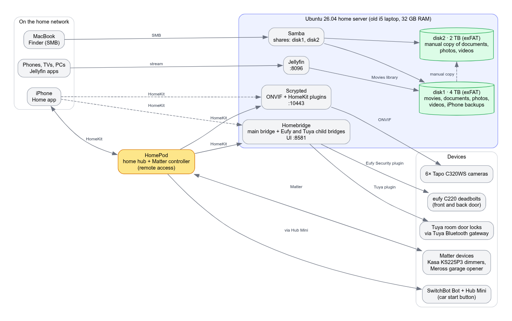

# home-server-setup

My Ubuntu home server on an old i5 laptop: Samba storage and family iPhone backups, Jellyfin movie streaming, and an Apple Home smart home bridged with Homebridge and Scrypted (lights, locks, six cameras, a garage door, and a DIY car remote start).



## What it does

- **Storage and backups.** Two repurposed hard drives (4 TB and 2 TB) are shared over Samba. The 4 TB drive holds documents, photos, videos, movies and the family's iPhone backups. The 2 TB drive holds a second copy of the documents, photos and videos.
- **Media streaming.** Jellyfin streams the movie library to any device on the home network (Requires login).
- **Smart home.** Everything shows up in one Apple Home app, with a HomePod as the home hub. Matter devices join Home directly. Locks and cameras that don't speak HomeKit are bridged by Homebridge and Scrypted running 24/7 on the home server.
- **DIY car start.** A SwitchBot at the push-start button starts the car from the Home app, instead of paying for an expensive retrofit remote starter.

## Hardware

| Part | Details |
|---|---|
| Server | Old laptop, Intel Core i5, 32 GB RAM, 512 GB NVMe SSD (encrypted root volume) |
| Disk 1 | 4 TB drive, exFAT, mounted at `/mnt/disk1` |
| Disk 2 | 2 TB drive, exFAT, mounted at `/mnt/disk2` |
| Home hub | HomePod (HomeKit hub, Matter controller, remote access) |
| Clients | iPhones, a MacBook, and any device with a Jellyfin app |

## Software (versions as of November 2026)

| Service | Version | Installed from | Default port |
|---|---|---|---|
| Ubuntu | 26.04 LTS | | |
| Samba | 4.23 | Ubuntu repositories | 445 |
| Jellyfin | 12.4 | Official Jellyfin apt repository | 8096 |
| Homebridge | 2.5 (UI 5.30) | Official Homebridge apt package | 8581 |
| Scrypted | 0.147 | Installed on the host | 10443 |

Everything runs directly on the host. There are no Docker containers.

## Smart home devices

| Device | How it connects |
|---|---|
| Kasa KS225P3 Matter smart dimmers (room light switches) | Matter, straight into Apple Home |
| Meross garage door opener adapter | Matter, straight into Apple Home |
| eufy C220 deadbolts (front and back door) | Homebridge, Eufy Security plugin |
| Generic Tuya room door locks | Homebridge, Tuya plugin, through a Tuya Bluetooth gateway |
| 6× Tapo C320WS cameras | Scrypted, ONVIF Camera plugin and HomeKit plugin |
| SwitchBot Bot at the car's start button | SwitchBot Hub Mini, then Apple Home |

## Docs

1. [Server and storage](docs/01-server-and-storage.md): the laptop, the two drives, Samba and the backup routine
2. [Jellyfin](docs/02-jellyfin.md): movie streaming
3. [Homebridge](docs/03-homebridge.md): eufy and Tuya locks
4. [Scrypted cameras](docs/04-scrypted-cameras.md): six Tapo cameras in Apple Home
5. [Matter devices](docs/05-matter-devices.md): dimmers and the garage door
6. [Car remote start](docs/06-car-remote-start.md): SwitchBot at the start button
7. [Roadmap and limitations](docs/07-roadmap.md)

## Security notes

- Jellyfin and Samba are only reachable on the home network. Remote access to the smart home goes through the HomePod hub.
- Server addresses are written as `<server-ip>`.

## Repository layout

```
README.md
docs/        one document per part of the setup
examples/    sanitized example configs
images/      architecture diagram (Graphviz source included) and screenshots
```
