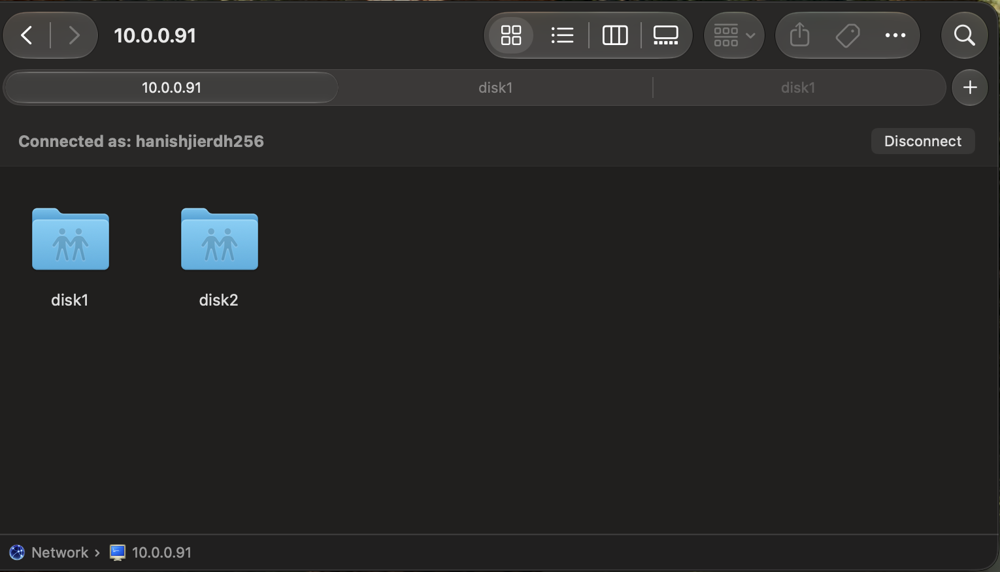

# Server and storage

[← Back to the overview](../README.md)

## The server

- Old laptop: Intel Core i5, 32 GB RAM, 512 GB NVMe SSD
- Ubuntu 26.04 LTS (x86_64), with the root volume on LUKS-encrypted LVM
- Runs 24/7 and hosts everything directly (no Docker containers): Samba, Jellyfin, Homebridge and Scrypted

## The drives

Both drives are old hard drives I repurposed. One was already an external drive. The other was an internal drive that now lives in an enclosure, so it works as an external drive too.

| Name | Size | Filesystem | Mount point | What it holds |
|---|---|---|---|---|
| disk1 | 4 TB | exFAT | `/mnt/disk1` | Everything: documents, photos, videos, movies, and the family's iPhone backups |
| disk2 | 2 TB | exFAT | `/mnt/disk2` | A second copy of the documents, photos and videos (no movies, no iPhone backups) |

## Samba

**Connect from a Mac:** in Finder choose Go → Connect to Server, enter `smb://<server-ip>`, and sign in with the Samba user. Both shares appear:

**To reproduce the setup:**

1. Install Samba: `sudo apt install samba`
2. Mount each drive at `/mnt/disk1` and `/mnt/disk2`.
3. Add a share block for each mount point to `/etc/samba/smb.conf`.
4. Create a Samba password for your Linux user: `sudo smbpasswd -a <username>`
5. Check the config with `testparm -s`, then restart: `sudo systemctl restart smbd`

**Gotcha, exFAT permissions:** exFAT has no Unix ownership or permissions. Access is decided by the mount options, so the user that Samba (and Jellyfin) runs as needs read/write access to the mount.

## iPhone backups

The family's iPhone backups are made with Finder on the Mac, then copied over Samba to `disk1`. Backing up straight onto the network share stalled partway through for me, so the backup is made locally first and then copied.

## What is stored where

| Data | disk1 (4 TB) | disk2 (2 TB) |
|---|---|---|
| Documents | yes | yes |
| Photos | yes | yes |
| Videos | yes | yes |
| Movies | yes | no |
| iPhone backups | yes | no |

The copy to disk2 is done by hand today. Automating it is on the [roadmap](07-roadmap.md).
