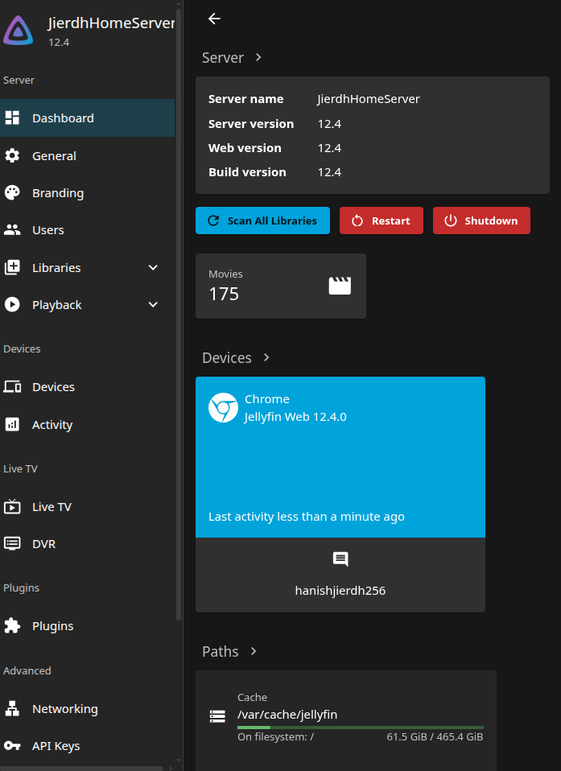

# Jellyfin

[← Back to the overview](../README.md)

Jellyfin streams the movies stored on `disk1` to every device on the home network.



## Setup

- **Version:** Jellyfin 12.4
- **Installed from:** the official Jellyfin apt repository, following the [Jellyfin Linux install guide](https://jellyfin.org/docs/general/installation/linux/). The packages are `jellyfin`, `jellyfin-server`, `jellyfin-web` and `jellyfin-ffmpeg8`.
- **Runs as:** the `jellyfin` systemd service, web interface on port 8096
- **Library:** one Movies library, pointing at the movies folder on `disk1`
- **Clients:** the Jellyfin web interface or the Jellyfin apps on phones, TVs and computers, all on the home network

Check that it is running:

```bash
systemctl is-active jellyfin
```

Then open `http://<server-ip>:8096` from any device on the network.

## Gotcha

The drives are exFAT, so file access is decided by the mount options (see [Server and storage](01-server-and-storage.md)). The `jellyfin` service user needs read access to the mount, or the library will look empty.

## Not done yet

Jellyfin is local only for now. Reaching it from outside the home is on the [roadmap](07-roadmap.md).