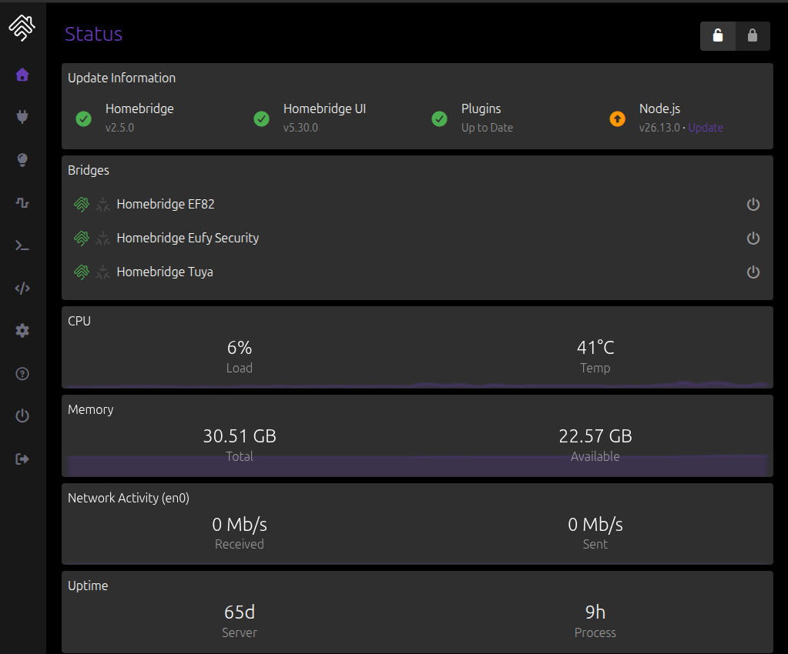

# Homebridge

[← Back to the overview](../README.md)

Homebridge makes devices that don't speak HomeKit show up in the Apple Home app. Here it handles the eufy deadbolts and the Tuya door locks.

## Setup

- **Version:** Homebridge 2.5, UI 5.30
- **Installed from:** the official Homebridge apt package, running as the `homebridge` systemd service
- **UI:** port 8581
- **Real config:** `/var/lib/homebridge/config.json`. It holds account details and pairing information, so it is not in this repo. A sanitized sketch is in [`examples/homebridge-config.example.json`](../examples/homebridge-config.example.json).

## Bridges

There are three bridges, as shown in the dashboard:

| Bridge | Purpose |
|---|---|
| Main bridge | The default Homebridge bridge |
| Homebridge Eufy Security | Child bridge for the Eufy Security plugin |
| Homebridge Tuya | Child bridge for the Tuya plugin |

Each plugin runs on its own child bridge, so a crash or slow plugin doesn't take the others down. Each bridge is added to the Home app separately (Add Accessory, then the setup code shown in the Homebridge UI).

## Locks

**eufy C220 deadbolts (front and back door).** Connected with the Eufy Security plugin, which logs in to the eufy account. They appear in Home as locks.

**Generic Tuya room door locks.** These are brandless locks. I set up an admin account for the Tuya plugin, and the locks are reached through a Tuya Bluetooth gateway. The Tuya plugin's own README covers the account setup, so the example config leaves that block out.

## Notes

- Plugin updates and the Node.js version are shown on the dashboard's Update Information card.
- Check the service with `systemctl is-active homebridge`. Logs are on the Logs page of the UI.
- Cameras are not on Homebridge. They run on [Scrypted](04-scrypted-cameras.md).
