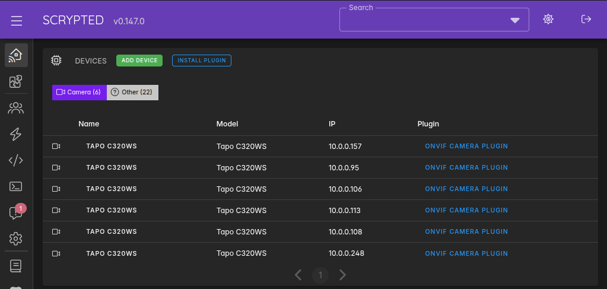

# Scrypted cameras

[← Back to the overview](../README.md)

Six Tapo C320WS cameras run through Scrypted and appear in the Apple Home app. They cover the front yard, back yard and the alleys around the property.

## Setup

- **Version:** Scrypted 0.147
- **Runs:** directly on the home server, 24/7 (no Docker). Its data folder is `~/.scrypted`.
- **Web interface:** port 10443 (HTTPS)
- **Plugins:** ONVIF Camera plugin (brings each camera in) and HomeKit plugin (exposes each camera to Apple Home)

## Adding a camera

1. In the Tapo app, create a camera account for the camera (under the camera's advanced settings). Scrypted uses this username and password, not your Tapo cloud login.
2. In Scrypted, choose Add Device, pick the ONVIF Camera plugin, and enter the camera's local address and the camera account details.
3. Enable the HomeKit extension on the camera, then add it to the Home app with the pairing code Scrypted shows.

Tip: give each camera a fixed address (a DHCP reservation on the router) so Scrypted never loses it after a reboot.

Locks and switches are on [Homebridge](03-homebridge.md). Cameras are on Scrypted instead.
