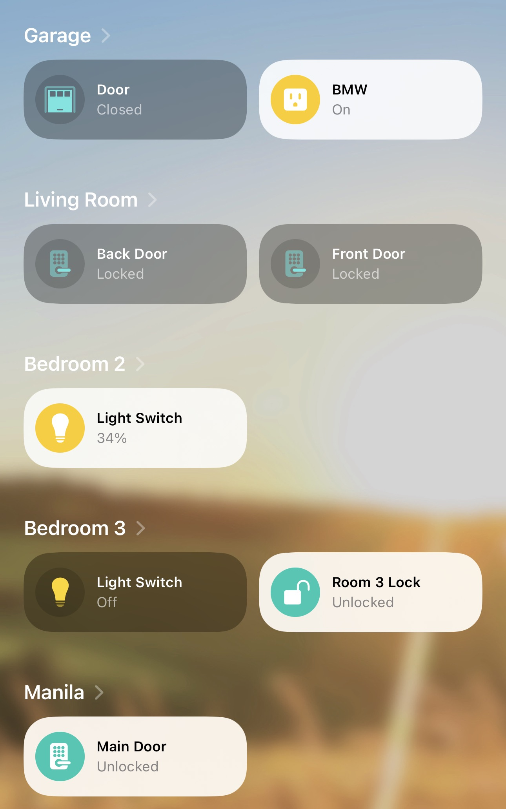

# Matter devices

[← Back to the overview](../README.md)

Matter devices join Apple Home directly. They don't go through Homebridge or Scrypted, so they keep working even if the server is off.

## Devices

| Device | Role |
|---|---|
| Kasa KS225P3 Matter smart dimmer switches | Room light switches with dimming |
| Meross garage door opener adapter | Opens and closes the garage door from the Home app |

## How they are added

1. Put the device in pairing mode (see its manual).
2. In the Home app choose Add Accessory and scan the Matter setup code on the device or its box.
3. Give it a name and a room.

The HomePod acts as the home hub and Matter controller. It is also what makes the devices controllable when I'm away from home.

Matter setup codes are usually printed on the devices.
